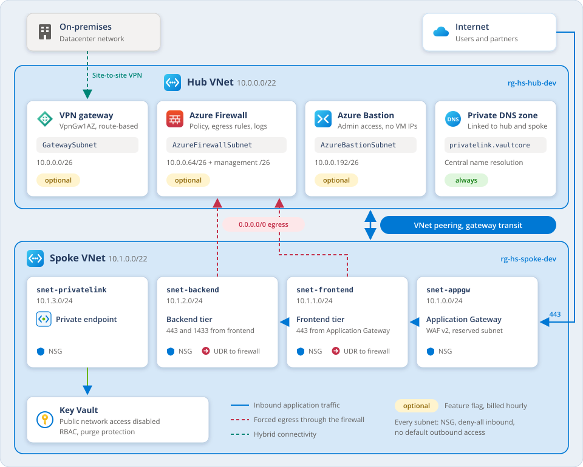

# Azure Hub and Spoke with Bicep

Hub and spoke network topology written in Bicep. The hub hosts shared connectivity and security services, the spoke hosts a tiered workload with private access to PaaS (Platform as a Service) through Private Link. Billable hub services are switched on with feature flags, so the same code serves a low-cost lab and a production-grade deployment.


## Architecture



## What it deploys

| Component | Default | Notes |
|---|---|---|
| Hub VNet with GatewaySubnet, AzureFirewallSubnet, AzureFirewallManagementSubnet, AzureBastionSubnet | Always | Subnets carved with `cidrSubnet()` from one address space |
| Spoke VNet with four tiers, one NSG (Network Security Group) per tier | Always | Explicit allow rules, deny-all inbound at priority 4096, no default outbound access |
| Bidirectional VNet peering | Always | Gateway transit enabled automatically when the VPN gateway is deployed |
| Private DNS zone linked to hub and spoke | Always | Central DNS for Private Link |
| Key Vault with private endpoint | Always | RBAC (Role-Based Access Control) authorization, purge protection, public access disabled |
| Azure Firewall with policy and route table | `deployFirewall` | Basic or Standard tier, egress rules for DNS, NTP (Network Time Protocol) and Windows Update |
| Azure Bastion | `deployBastion` | Administrative access without public IPs on VMs (Virtual Machines) |
| VPN gateway | `deployVpnGateway` | Zone-redundant SKU, 30 to 45 minutes to provision |

## Design decisions

- **Two resource groups.** Hub and spoke have different owners and lifecycles: platform team for the hub, workload team for the spoke.
- **Forced tunnelling only where it matters.** Frontend and backend tiers route `0.0.0.0/0` to the firewall. The Application Gateway subnet keeps direct internet routing, as required by Application Gateway v2.
- **Private by default.** `defaultOutboundAccess: false` on every subnet, Key Vault reachable only through its private endpoint, DNS resolution through the hub zone.
- **Feature flags for cost.** The default lab deployment contains no hourly-billed service.
- **Fits the landing zone.** Pass the workspace ID from [azure-bicep-landing-zone](https://github.com/Solisys-Cloud/azure-bicep-landing-zone) in `logAnalyticsWorkspaceId` to send firewall logs to the platform workspace. The public IPs created here are the hub components that the landing zone public IP policy is meant to allow.

## Repository structure

```text
.
├── bicepconfig.json
├── docs/architecture.svg           Architecture diagram
├── infra
│   ├── main.bicep                  Entry point (subscription scope)
│   ├── main.bicepparam             Lab parameters
│   └── modules
│       ├── hub-network.bicep
│       ├── spoke-network.bicep
│       ├── peering.bicep
│       ├── private-dns.bicep
│       ├── key-vault.bicep
│       ├── firewall.bicep
│       ├── bastion.bicep
│       └── vpn-gateway.bicep
├── pipelines/azure-pipelines.yml
└── .github/workflows/bicep-validate.yml
```

## Deploy

```bash
az login
az account set --subscription "<subscription-id>"

az deployment sub what-if \
  --location westeurope \
  --template-file infra/main.bicep \
  --parameters infra/main.bicepparam

az deployment sub create \
  --name hub-spoke \
  --location westeurope \
  --template-file infra/main.bicep \
  --parameters infra/main.bicepparam
```

Enable a billable component for a test run:

```bash
az deployment sub create \
  --name hub-spoke-fw \
  --location westeurope \
  --template-file infra/main.bicep \
  --parameters infra/main.bicepparam deployFirewall=true
```

## Cost

| Configuration | Billing |
|---|---|
| Default lab | VNets, peering, NSGs and DNS zone are free or near-free; peering traffic, the private endpoint and Key Vault operations are billed per use |
| Firewall, Bastion, VPN gateway | Billed per hour while deployed; check the Azure pricing calculator and delete after testing |

## Clean up

Key Vault purge protection keeps the vault name reserved for 90 days after deletion.

```bash
az group delete --name rg-hs-spoke-dev --yes
az group delete --name rg-hs-hub-dev --yes
```

## Roadmap

- Application Gateway with WAF (Web Application Firewall) policy in `snet-appgw`
- Internal load balancer and VM scale sets for frontend and backend tiers
- Azure Firewall diagnostic workbook and network flow logs
- Second spoke with spoke-to-spoke routing through the firewall

## License

[MIT](LICENSE)
